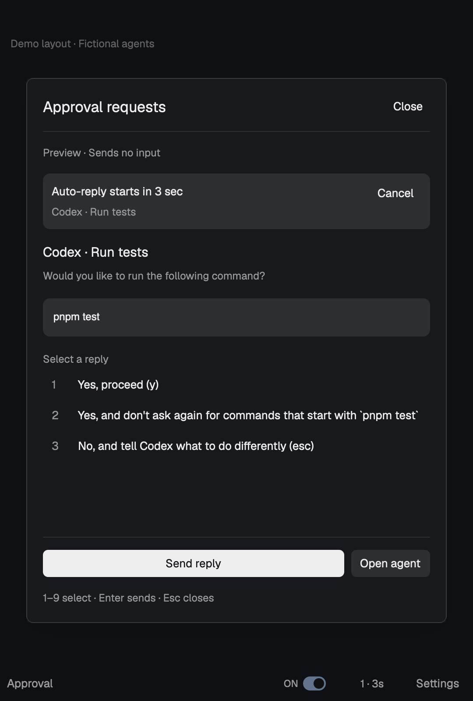
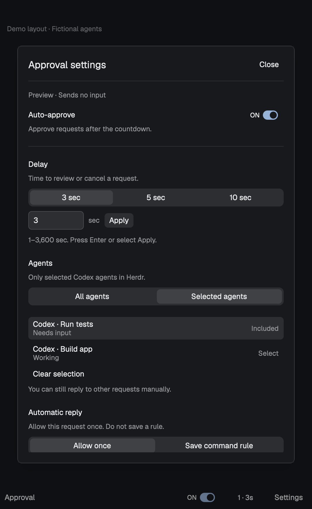
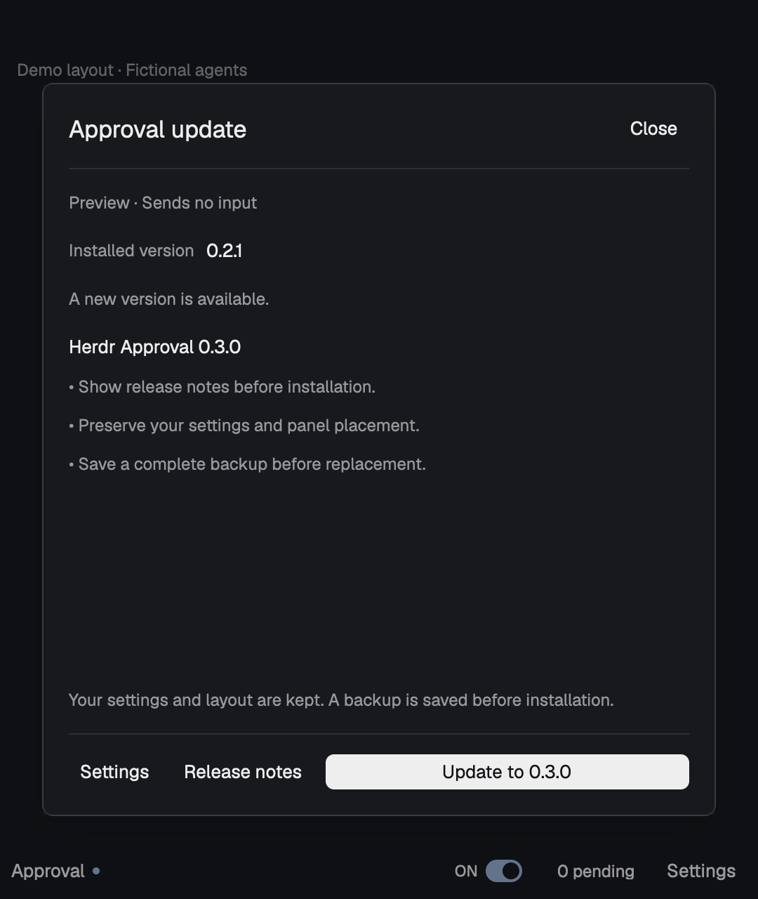

# Herdr Approval

Reply to Codex permission requests in Herdr, manually or on a timer. Choose which agents use automatic approval and how long they wait.


*The optional compact bar and settings popup. All examples use fictional requests.*

## Install

To let an agent install the mod, give it this instruction:

```text
Read ~/.config/herdr-app/AGENTS.md, then install the Approval mod from https://github.com/iyk2h/herdr-approvals.
```

To install it yourself, run the installer from a copy of this repository:

```sh
python3 tools/install.py
herdr-app check ~/.config/herdr-app/mods/approvals
```

The panel opens on the right, 360px wide.
The installer leaves Cockpit, key bindings, layouts, and saved settings unchanged.
If the mod folder already exists, the installer stops. Add `--update` to replace the mod.
With `--update`, the installer saves the previous mod in `~/.local/share/herdr-approvals/backups/`.
It can replace `mod.json`, so check any changes that you made to that file.

### Compact bar

The 40px bar is optional. To use it, add this block to a personal layout:

```json
{"id":"approval-widget","type":"block","size":{"px":40},"content":{"mod":"approvals","props":{"compact":true,"panelId":"approval-widget"}}}
```

The bar keeps its height. **Settings** and the request count open popups.
To place the full panel yourself, set `place` to `none` in `mod.json`. Then add a layout block with `content: {mod: "approvals"}`.
If you use the optional `keys.json` bindings, merge them with your existing bindings.

## Reply to a request

Select a numbered reply. Then press Enter or select **Send reply**.
**Open agent** shows the agent's terminal.
In the bar, select the request count to read the command and its replies.
Other mods can open these views with the `approvals.settings` and `approvals.requests` commands. The commands send no reply.

<details>
<summary>View a request</summary>



</details>

## Automatic approval

Automatic approval is off until you turn it on in **Settings**.

| Setting | What it does |
| --- | --- |
| Auto-approve | Sends the automatic reply when the delay ends. |
| Delay | 3, 5, or 10 seconds. For a custom delay, enter 1–3,600 whole seconds and select **Apply**. |
| Agents | All local Codex agents, or only the agents that you select. |
| Automatic reply | **Allow once** or **Save command rule**. |
| Connection | Herdr directly, or an existing local Cockpit installation. |

**All agents** includes Codex agents that start later.
With **Selected agents**, you can select an agent before it sends a request.
A selection lasts for that terminal process. A new process needs a new selection.

<details>
<summary>View agent selection</summary>



</details>

**Allow once** approves only the current request.
**Save command rule** selects the command rule that Codex offers.
If Codex offers no supported rule, the mod selects **Allow once**. If Codex offers several rules, you reply manually.
Automatic replies to terminal input requests, such as Ctrl+C, always use **Allow once**.
Automatic approval skips the all-command and bypass options that it recognizes.

### Countdowns

Each agent has its own countdown. When several countdowns end together, the mod sends the replies one at a time.

- Selecting a reply or opening the request details stops the automatic reply for that request. Other countdowns continue.
- Closing the details does not restart the countdown. Closing settings leaves all countdowns running.
- In the full panel, Esc stops all current automatic replies. In a popup, Esc only closes the popup.
- Canceling a countdown does not reject the request. You can still reply manually.
- Changing the delay restarts the countdowns with the new delay.

You can cancel until sending starts. Herdr can still delay delivery after that.
If the reply status is unknown, check the terminal before replying. The mod stops sending to that terminal process.

## Scope and requirements

- Local Codex agents only. Other agents, such as Claude Code, and remote sessions are not supported.
- Codex permission menus must be in English. You can chat with Codex in any language.
- Command execution and terminal input requests. For wrapped or incomplete input requests, reply in the terminal.
- No replies to authentication prompts, text questions, or checkbox forms.
- Tested on macOS. Linux is not validated.

The mod needs Herdr desktop with native JavaScript mods and herdr-core 0.1.21 or a compatible version.
Herdr must be able to run `hc` and `/bin/sh`. Approval controls need neither Node nor Python.

## Updates

Open **Settings → Updates** to see the installed version and the release notes.
The mod uses curl to check GitHub for a stable release at startup and every six hours.
A dot beside **Approval** shows that a newer release is available. **Check for updates** checks again immediately.

To install, read the changes and select **Update to version**. Nothing installs without that click.
Pending requests block installation, so reply to them first. Approval replies pause while the update runs.
Installation needs Python 3, curl, and `herdr-app`.

The updater downloads the selected release from this repository and verifies its SHA256 checksum.
It checks the new mod and saves a backup in `~/.local/share/herdr-approvals/backups/`.
If replacement or validation fails, it restores that copy.
Your settings, agent selection, panel placement, layout, and personal `mod.json` are kept. Herdr and your agent sessions stay open.
Older installations without **Updates** need one manual update: `python3 tools/install.py --update`.

<details>
<summary>View the update popup</summary>



</details>

## Cockpit

The mod connects to Herdr directly by default. You can switch to an existing local Cockpit installation when no request is pending.
If Cockpit already approves the same agents automatically, turn off its automatic sender before you turn on **Auto-approve**, so that the two do not compete.

## Development and license

Development checks use Node 24 and Python 3, with no npm dependencies.

```sh
npm test
npm run check:package
npm run check:install
npm run check:updates
python3 tools/native-check.py
```

See [design](docs/design.md), [validation](docs/validation.md), and [releasing](docs/releasing.md) for details.

Apache-2.0. The Codex prompt parser is adapted from Cockpit and herdr-relevo, with attribution retained.
See [LICENSE](LICENSE), [NOTICE](NOTICE), and [LICENSES](LICENSES/).
