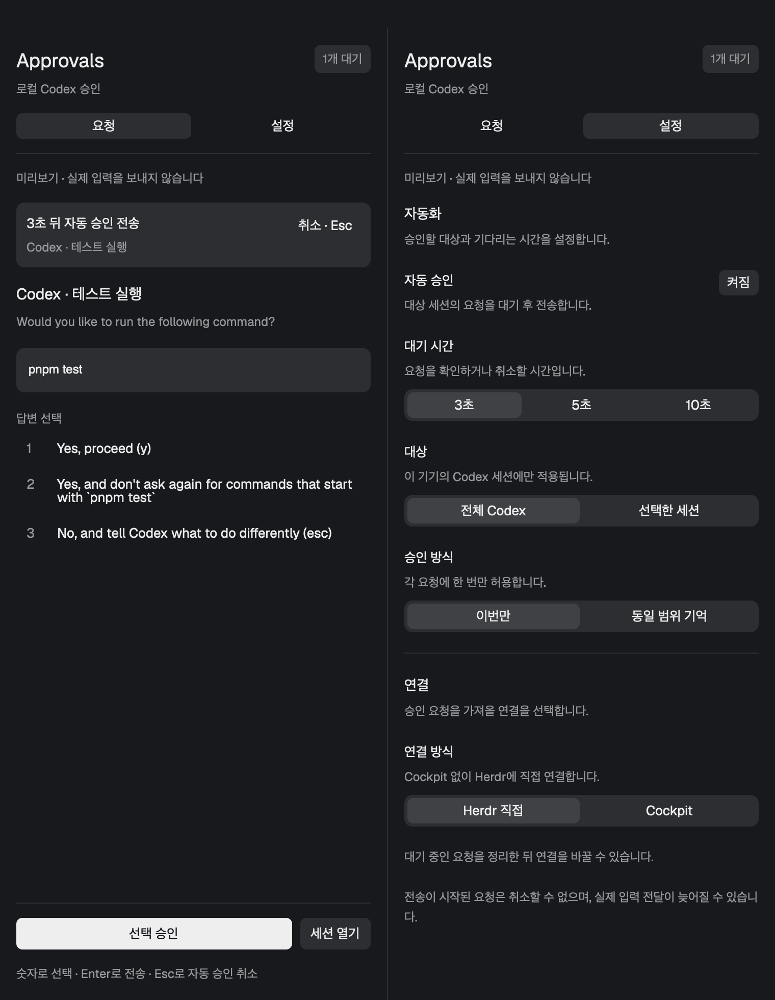

# Herdr Approvals

A standalone approval panel for Herdr. Cockpit is optional.



The panel shows complete local Codex permission requests, lets you select a reply,
and optionally starts a configurable countdown before sending it. Selecting an
answer pauses that request's automatic approval. Esc cancels automatic approval;
Enter sends your selected answer. Cancellation does not send a rejection.

## Requirements

- Herdr desktop app with native JavaScript mods and herdr-core 0.1.21 or compatible.
- macOS or Linux, `hc` and `/bin/sh` available to Herdr.
- A local Codex session that reports blocked status and displays the supported
  English single-choice permission menu. Claude, remote, authentication, free-text
  and multi-select questions are not input targets in this version.

No Node, Python, Rust build or separate server is required to run the mod.

## Install

Copy `mods/approvals/` into `~/.config/herdr-app/mods/approvals/`, or use the optional
installer with Python 3:

```sh
python3 tools/install.py
herdr-app check ~/.config/herdr-app/mods/approvals
```

The installer refuses an existing folder unless `--update` is given. Updates first
save the previous mod in `~/.local/share/herdr-approvals/backups/`. It does not edit
Cockpit, existing key bindings, or enable automatic approval.

The new mod docks on the right. To place it yourself, set its mod.json `place` to
`none` before copying and add a layout block with `content: {mod: "approvals"}`.
Merge any desired bindings from `keys.json` after checking for conflicts.

New installations default to automatic approval off and allow once. The policy
button can enable a recognized narrow remembered scope. Settings offer 3, 5 or 10
seconds and all local Codex sessions or explicitly selected sessions. Broad all/future/bypass
options are not automatic targets. Auto settings are shared between panel copies.

## Optional Cockpit connection

With no pending requests, the connection button switches between native Herdr and
an existing local Cockpit installation. The adapter uses its CLI only when selected
and never installs or updates it. Native mode does not require Cockpit files or
connect to its hub. Connection failures do not fall back to another sender.

The mod shares a durable per-request claim between both connections. Other tools
and Cockpit's own automatic senders do not participate in this protocol. Disable
an existing custom automatic sender before enabling this one for the same sessions.
Keep its files and settings backed up. The installer deliberately does not migrate
or remove an existing Cockpit customization.

## Delivery and recovery

Three seconds is the cancel window before dispatch, not a promise about execution
time. Core can delay key delivery until the terminal is quiet. Once dispatch starts,
the mod cannot withdraw that input or atomically prevent an external user/CLI from
changing the prompt. It re-reads the request before delivery but cannot guarantee
zero stale input with the current core API.

An uncertain delivery quarantines that terminal process rather than retrying it.
Open the terminal and confirm its state. A restarted root process has a new
identity. Confirmed attempts and cancellations remain in a versioned core document;
question/command bodies are not saved there. Cancellation is immediate in memory;
`controller.flush()` acknowledges its durable write. A hard crash before that
acknowledgement can lose the cancellation.

## Development and verification

Node 24 is used only by development tests. There are no npm dependencies.

```sh
npm test
npm run check:package
herdr-app check ./mods/approvals
python3 tools/core-spike.py
python3 tools/preview.py
```

`core-spike.py` creates its own HC_SESSION and scratch XDG directories, runs a
fictional TUI, verifies native screen parsing and actual key delivery, then stops
only that core. It never sends input to an existing user terminal.
`preview.py` uses a separate Herdr home and a fictional request for the screenshot.
The native check mode starts no IO, helper processes or persistent writes.

## Gallery and license

The repository follows the Herdr mod gallery format: `mods/approvals/`, `RECIPE.md`,
`preview.png` and optional `keys.json`. A public repository with the `herdr-mod`
topic can be indexed by the gallery. Publishing is separate from local testing.

Apache-2.0, with Cockpit MIT and herdr-relevo attribution preserved in `NOTICE` and
`LICENSES/`. See `docs/design.md` for the module boundaries and delivery limitations.
