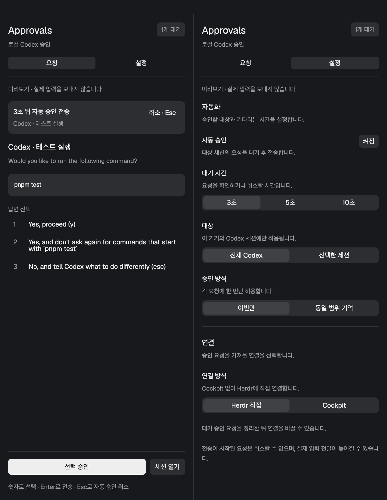

# Herdr Approvals

A compact approval panel for local Codex sessions in Herdr. It works without
Cockpit and fits into an existing layout. Request and settings tabs separate the
current decision from persistent automation preferences.

## What you see

A roughly 360px right panel using the active Herdr theme. A title and waiting count
sit above Request/Settings tabs. Requests show a compact countdown with cancel,
the session, a monospace command, left-aligned numbered choices and a fixed action
row. Settings use labeled sections with descriptions and segmented choices for
3/5/10 seconds, all/selected sessions, once/remember and native/Cockpit connection.

## How it behaves

Only recognized local Codex permission menus are input targets. Automatic approval
starts off. Enabling it gives each eligible request a three-second cancel window.
Selecting an answer makes that request manual. Numbers choose; Enter submits;
Esc cancels the current automatic request without sending deny. Shared settings
update every panel copy. An uncertain delivery is not retried automatically.

## Built from

One native `View` in `mods/approvals/main.js`, GPUI base controls, a pure parser,
policy, controller and journal, and injected native/Cockpit providers. Native mode
uses `hc ls/get/read/keys`. A small shell helper speaks versioned JSON-RPC over
`hc connect` for compare-and-set claims in the mod's own core document. The optional
Cockpit transport reads its installation config and invokes its agents CLI.

## Watch out

This is a macOS/Linux local-Codex first version. Do not treat arbitrary numbered
text as a permission menu. Preserve the complete command in identity. Do not send
from render/checking mode. All responses must use the same controller and durable
claim. Core key delivery can be delayed and cannot be cancelled once dispatched;
three seconds is not the exact approval time. External senders are not fenced.

## Done when

Pure tests pass; native check starts no IO; isolated native smoke sends exactly
one answer to a fictional TUI; a clean preview home works without Cockpit; and
install/update never overwrite an existing unrelated mod, keys or layout.
